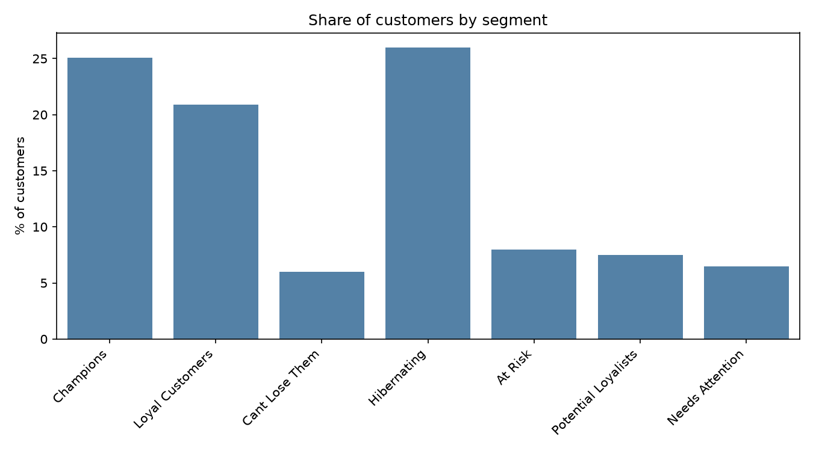
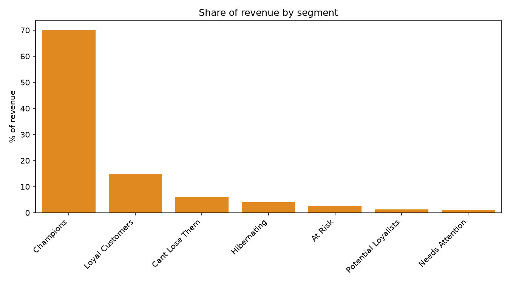

# Online Retail: RFM Customer Segmentation

SQL (DuckDB) analysis of the UCI Online Retail II dataset (~1M transactions +  Dec 2009 to Dec 2011) to segment customers by Recency, Frequency and Monetary value

## Key finding
Champions are 25% of customers but 70% of revenue. Hibernating customers are 26% of customers but only 4% of revenue

## Method
1. **Explore:** 22.8% of rows had no customer ID, 19,494 were cancellations 25,700 had zero or negative quantity or price
2. **Clean (SQL):** removed those rows, plus orders that were later fully cancelled (e.g. one 168k order cancelled 12 minutes later) leaving 795,637 rows and 5,850 customers
3. **RFM metrics:** recency (days before 2011-12-10), frequency (distinct invoices), monetary (total spend)
4. **Score:** `NTILE(5)` on each metric where 5 is always best
5. **Segment:** `CASE WHEN` on recency and frequency scores into 7 segments

## Recommendations
- **Champions:** protect and reward them (early access, loyalty perks)
- **Cant Lose Them:** run a win-back campaign They bought often but have gone quiet
- **Hibernating:** low-cost reactivation only since revenue per customer is low

## Limitations
- Ties are split by customer_id so segment boundaries are approximate for identical values
- Only exact full cancellations are matched Partial cancellations are still counted
- Some rows have a price of 0.001, which is left as is
- Segment rules use recency and frequency only Monetary is reported but not used in the rules

## Files
- `rfm.ipynb`: step-by-step exploration, cleaning and charts
- `queries.sql`: the full pipeline as one query

## Tools
DuckDB, SQL (CTEs, window functions), Python, pandas, seaborn

